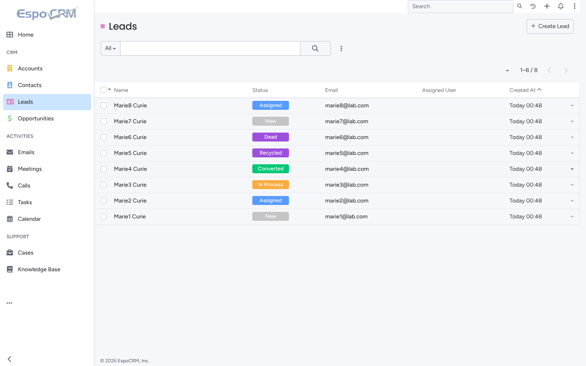
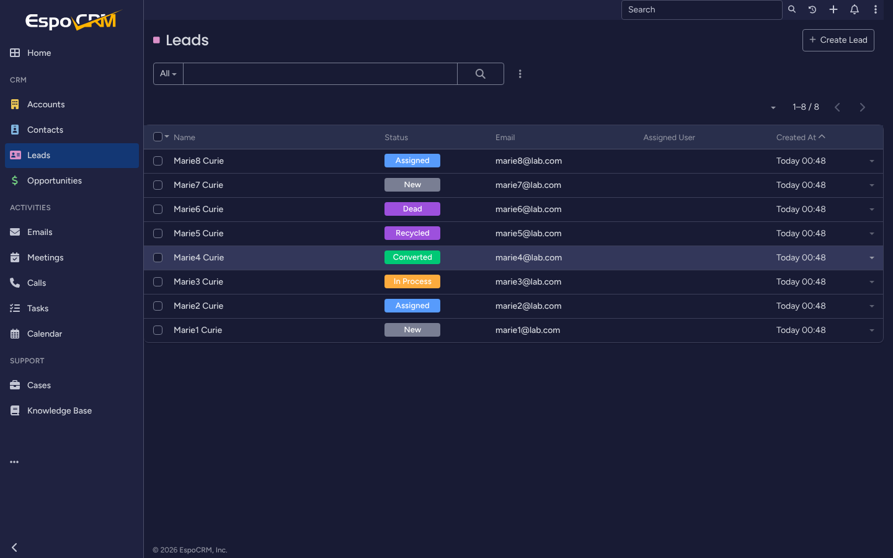
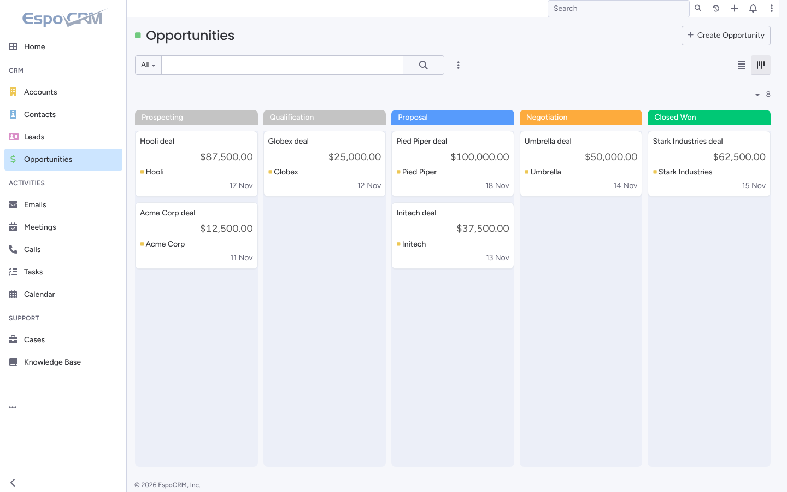
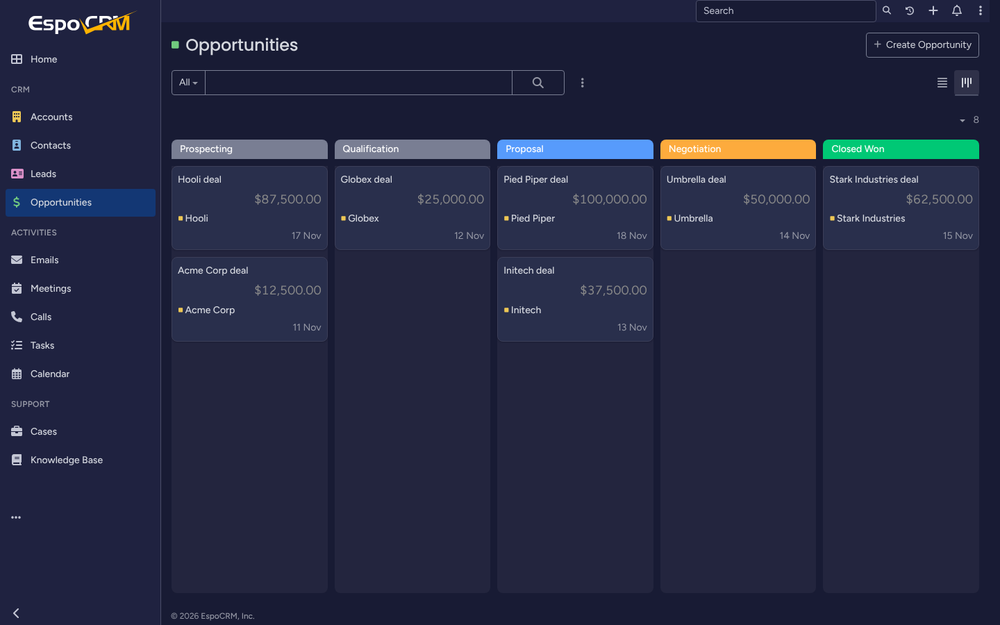
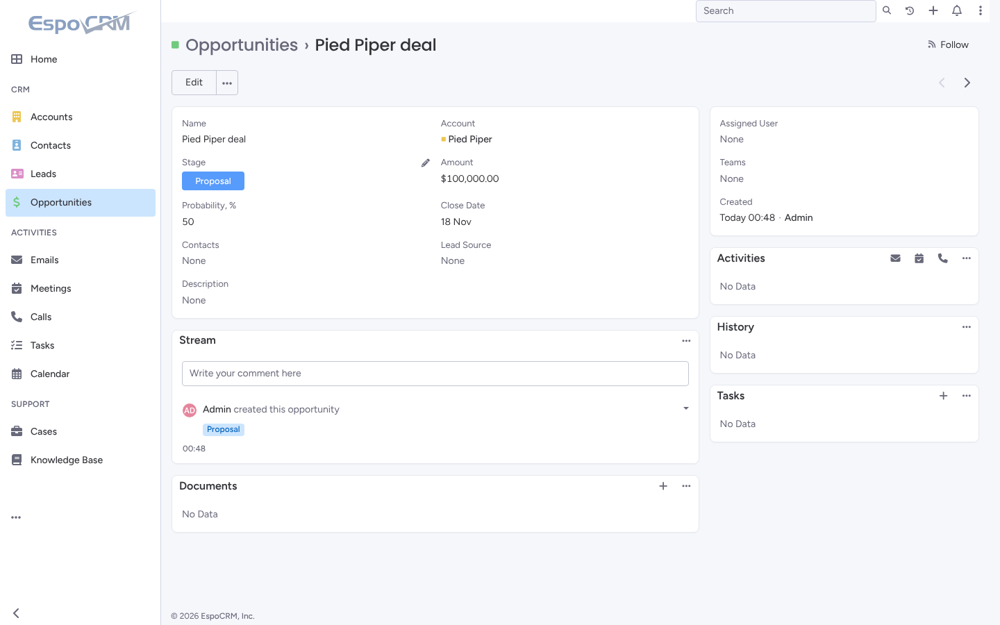
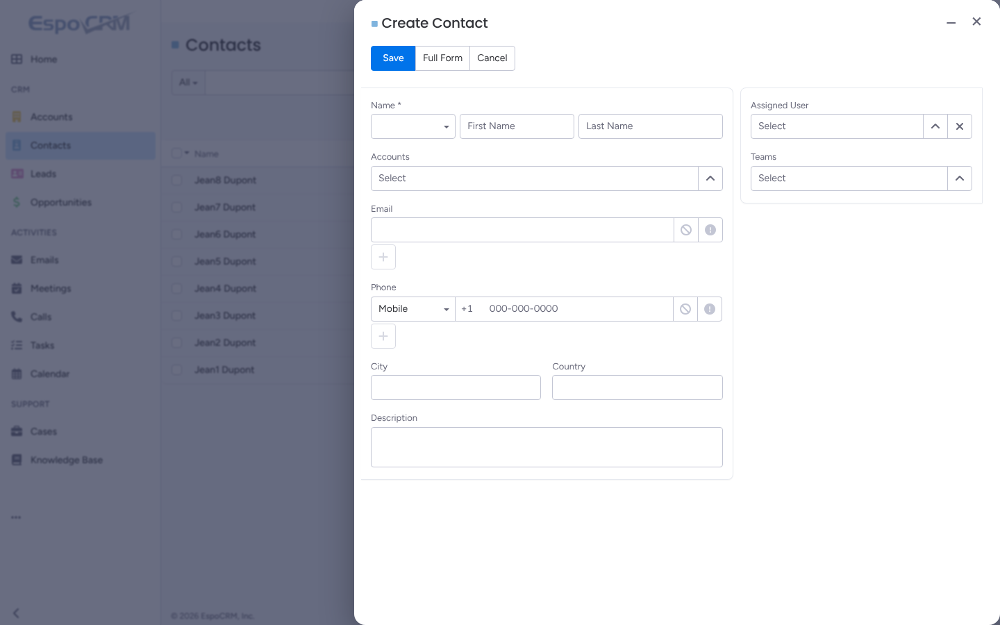
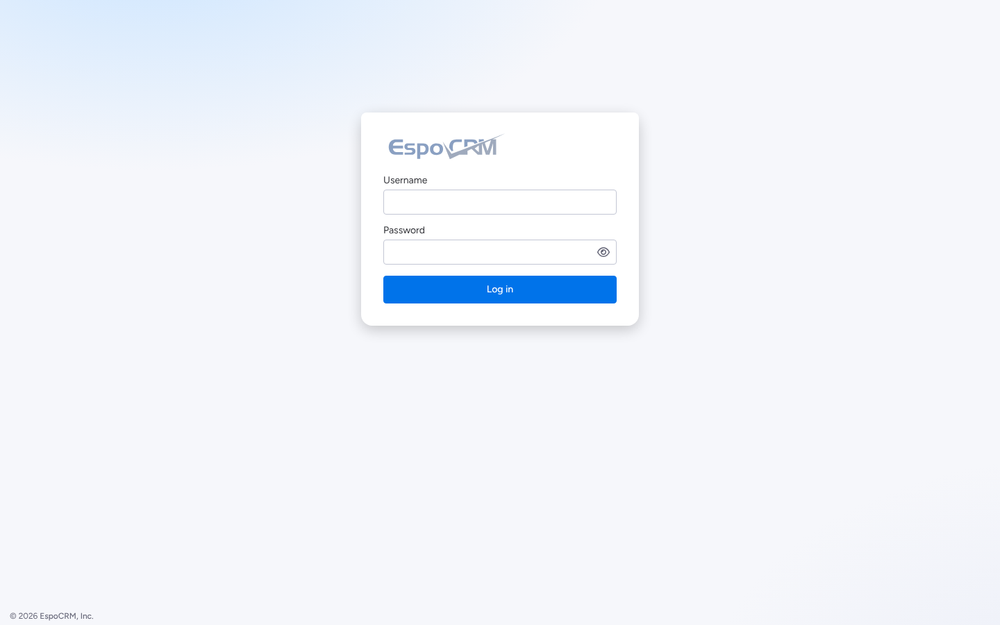

# Vibe Theme pour EspoCRM

Thème clair **Vibe** et sombre **Vibe Dark** pour EspoCRM, construits sur le design system
[monday.com Vibe](https://github.com/mondaycom/vibe) : mêmes couleurs, typographie, rayons,
ombres, menus et pastilles de statut que monday.com.

| Clair | Sombre |
|---|---|
|  |  |
|  |  |
|  |  |



## Installation

1. Téléchargez `dist/vibe-theme-1.0.0.zip`.
2. EspoCRM → **Administration → Extensions → Upload**, puis **Install**.
3. Choisissez le thème :
   - pour tout le monde : **Administration → User Interface → Theme** = `Vibe` ou `Vibe Dark` ;
   - ou par utilisateur : **Preferences → Theme**.

L'option *Navbar* (barre latérale ou en haut) reste disponible.

En ligne de commande : `php command.php extension --file=vibe-theme-1.0.0.zip`.

Testé sur EspoCRM 10.0.9 (PHP 8.3, PostgreSQL 16), en barre latérale et en haut, sur bureau (1440 px) et mobile (390 px).

## Ce qui change

- **Typographie Vibe** : Figtree pour le texte, Poppins pour les titres. Les polices sont incluses dans l'extension : aucun appel à Google Fonts.
- **Couleurs Vibe** : bleu primaire `#0073ea`, textes `#323338` / `#676879`, bordures `#d0d4e4`. En sombre : fonds `#181b34` / `#292f4c`.
- **Pastilles de statut monday** dans les listes, le kanban et les fiches : *Done* vert `#00c875`, *Working on it* orange `#fdab3d`, *Stuck* rouge `#df2f4a`, bleu, violet et gris. Dans le flux d'activité, les libellés restent en version teintée, plus discrète.
- **Kanban façon board** : en-têtes de colonnes colorés selon le statut, colonnes teintées, cartes qui se soulèvent au survol.
- **Navigation** : onglets de la barre latérale en pilule, onglet actif en `#cce5ff`, intitulés de section en petites capitales, champ de recherche visible.
- **Boutons Vibe** : primaire plein, secondaire bordé, tertiaire transparent. Survols en 100 ms et léger effet d'enfoncement au clic.
- **Champs** : la bordure fonce au survol ; au focus, bordure bleue et halo léger.
- **Menus, modales et infobulles** : coins arrondis à 8 et 16 px et ombres de Vibe. Les modales s'ouvrent avec une courte animation.
- **Accessibilité** :
  - anneau de focus Vibe visible uniquement au clavier (`:focus-visible`) ;
  - animations coupées si le système demande `prefers-reduced-motion` ;
  - textes des libellés teintés contrôlés en clair comme en sombre.
- **Graphiques et calendrier** : palette de couleurs Vibe.

## Structure

```
espocrm-vibe-theme/
├── src/                     # Sources CSS (à modifier)
│   ├── tokens-light.css     # Tokens Vibe clairs (--vibe-*)
│   ├── tokens-dark.css      # Tokens Vibe sombres
│   ├── espo-mapping.css     # Tokens Vibe -> variables CSS d'EspoCRM
│   ├── components.css       # Finitions des composants (communes aux deux thèmes)
│   └── fonts.css            # @font-face Figtree / Poppins
├── extension/               # Contenu de l'extension EspoCRM
│   ├── manifest.json
│   └── files/
│       ├── custom/Espo/Modules/VibeTheme/Resources/   # Métadonnées des thèmes et traductions
│       └── client/custom/modules/vibe-theme/          # CSS générés et polices
├── dist/vibe-theme-1.0.0.zip
└── build.py                 # Génère les CSS et le zip
```

Les tokens sont préfixés `--vibe-*` parce que plusieurs noms de Vibe (`--link-color`,
`--border-radius-small`…) existent déjà dans EspoCRM avec un autre sens.

Chaque feuille importe d'abord le CSS du thème EspoCRM d'origine (`espo.css` ou `dark.css`),
puis applique les surcharges. Une mise à jour d'EspoCRM ne casse donc pas le thème.

## Personnaliser

Modifiez `src/`, puis :

```bash
python3 build.py   # régénère extension/.../css/*.css et dist/vibe-theme-<version>.zip
```

Exemple : pour une autre couleur de marque, changez `--vibe-primary`, `--vibe-primary-hover` et
`--vibe-primary-selected` dans `src/tokens-light.css` et `src/tokens-dark.css`.

Pensez à incrémenter `version` dans `extension/manifest.json` avant de réinstaller. Si les
anciens styles restent affichés, videz le cache (**Administration → Clear Cache**).

## Licences

- Polices Figtree et Poppins : SIL Open Font License 1.1 (fichiers `OFL.txt` fournis).
- Les valeurs de design proviennent de monday.com Vibe (licence MIT).
